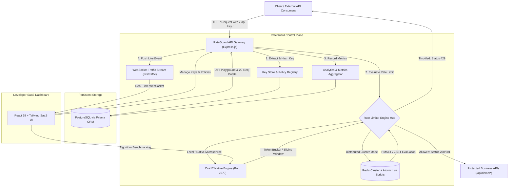

# RateGuard — Distributed API Rate-Limiting & Traffic Control Platform


**RateGuard** is a high-performance, production-grade distributed API traffic management and rate-limiting platform. It protects backend APIs from excessive request volumes, burst spikes, credential abuse, and DDoS attacks by enforcing configurable rate limits for users, API keys, and individual API endpoints.

---

## 1. Architectural Overview



---

## 2. Core Rate-Limiting Algorithms

### A. Token Bucket Algorithm
Each API client is assigned a bucket filled with tokens:
- **Refill Rate (\(r\)):** \(\frac{\text{Limit}}{\text{Window}}\) tokens replenished continuously per second.
- **Burst Capacity (\(C\)):** Maximum token buffer the bucket can hold during idle periods.
- **Request Cost:** Each incoming request consumes 1 token.
- **Throttling Condition:** When \(\text{Tokens} < 1\), requests are rejected with **HTTP 429 Too Many Requests**.
- **Retry-After Calculation:** \(\lceil \frac{1 - \text{Tokens}}{r} \rceil\) seconds.

```text
       Tokens Refill at rate r (e.g. 100 tokens / 60 sec)
                     │
                     ▼
           ┌───────────────────┐
           │   Token Bucket    │  Capacity = 120 tokens (burst)
           │   [● ● ● ● ● ●]   │  Current  = 45 tokens
           └─────────┬─────────┘
                     │ Request consumes 1 token
                     ▼
         Allowed (Remaining: 44)
```

### B. Sliding Window Algorithm
Maintains a moving chronological time window of duration \(W\) using a timestamp deque:
- **Eviction:** Discards all timestamps where \(t_{\text{req}} \le t_{\text{current}} - W\).
- **Evaluation:** If \(\text{Count}(t) < \text{Limit}\), request is accepted and current timestamp appended.
- **No Boundary Glitches:** Eliminates the classic fixed-window vulnerability where an attacker sends \(2 \times \text{Limit}\) during the window rollover transition.

---

## 3. Algorithm Comparison Matrix

| Property | Token Bucket | Sliding Window |
| :--- | :--- | :--- |
| **Burst Handling** | Highly flexible (configurable burst capacity) | Strict capping (hard window limit) |
| **Memory Footprint** | \(O(1)\) (tokens count + timestamp) | \(O(N)\) (where \(N\) is requests in window) |
| **Reset Behavior** | Continuous replenishment | Moving window roll-off |
| **Ideal Use Cases** | Developer APIs, webhooks, high-throughput ingest | Financial transactions, checkouts, login attempts |

---

## 4. Redis Distributed Mode (Atomic Lua Scripts)

To eliminate race conditions across multiple distributed API servers, RateGuard runs rate-limiting logic inside **Redis Lua scripts**:
1. **Linearizable Atomicity:** Redis executes Lua scripts as a single atomic unit. No two API gateways can observe interleaved state.
2. **Minimal Round-Trips:** State retrieval, elapsed time calculation, token replenishment, and writing are executed inside Redis in **1 network round-trip**.
3. **Automatic TTL Eviction:** State keys carry a sliding TTL (\(2 \times \text{Window}\)), preventing orphan keys from consuming memory.

---

## 5. Technology Stack

- **Frontend:** React 18, TypeScript, Vite, Tailwind CSS, Recharts, Lucide Icons.
- **Backend API:** Node.js, Express.js, TypeScript, WebSocket (`ws`).
- **Rate-Limiting Engine:** C++17 native engine with microsecond monotonic clocking (`QueryPerformanceCounter`), concurrency locks, and standalone HTTP service.
- **Storage:** Redis (distributed Lua rate-limiter state), PostgreSQL (users, keys, policies, logs) via Prisma ORM.
- **Testing:** Google Test / native C++ unit tests, Vitest backend tests, k6 load testing scripts.
- **Containerization:** Multi-stage Dockerfiles and Docker Compose.

---

## 6. Project Structure

```text
rate guard/
├── frontend/                     # React 18 + Vite + Tailwind SaaS Dashboard
│   ├── src/
│   │   ├── components/           # UI widgets & modals
│   │   ├── layouts/              # AppLayout (Sidebar, TopNav, TimeRange)
│   │   ├── pages/                # Dashboard, API Keys, Policies, Live Traffic, etc.
│   │   ├── services/             # API client
│   │   └── hooks/                # WebSocket traffic hook
│   └── package.json
│
├── backend/                      # Node.js + Express + TypeScript Gateway
│   ├── src/
│   │   ├── controllers/          # API Key, Policy, Analytics, Demo, Benchmarks
│   │   ├── middleware/           # rateguardMiddleware (token extraction, headers, 429)
│   │   ├── services/             # rateLimiterService, cppEngineClient, redisService
│   │   ├── websocket/            # trafficStream (WebSocket live broadcast)
│   │   └── index.ts
│   ├── prisma/
│   │   └── schema.prisma         # Users, ApiKeys, Policies, RequestLogs
│   ├── tests/                    # Vitest integration tests
│   └── package.json
│
├── rate-limiter/                 # Native C++ Rate Limiting Microservice
│   ├── include/                  # RateLimiter.h, TokenBucket.h, SlidingWindow.h
│   ├── src/                      # engine.cpp (C++ HTTP microservice)
│   ├── tests/                    # test_rate_limiter.cpp (Unit & Concurrency tests)
│   ├── CMakeLists.txt
│   └── Dockerfile
│
├── redis/
│   └── lua/
│       ├── token_bucket.lua      # Atomic Redis Token Bucket
│       └── sliding_window.lua    # Atomic Redis Sliding Window
│
├── load-tests/
│   └── rateguard.js              # k6 load testing script
│
├── docker-compose.yml            # Full cluster orchestration
└── README.md
```

---

## 7. Quickstart & Single-Command Combined Mode

### Combined Mode (Frontend + Backend + C++ Engine)
You can run the entire platform with a single command:

```bash
# From the project root
npm start
# or
node start.js
# or on Windows, double-click:
run.bat
```

This single command will:
1. Detect and compile the native C++ Rate-Limiting Engine if needed.
2. Launch the C++ Rate-Limiting Engine daemon on `http://127.0.0.1:7070`.
3. Launch the Express.js Backend on `http://localhost:4001`.
4. Serve the React 18 production dashboard, API endpoints, and WebSocket stream on the same unified port: **`http://localhost:4001`**.
5. Gracefully shut down all background processes when you press `Ctrl+C`.

---

### Option A: Run via Docker Compose
Start all 5 containers (PostgreSQL, Redis, C++ Rate Limiter, Node Gateway, React Frontend) in one command:

```bash
docker compose up --build
```
- Frontend UI: `http://localhost:3000`
- Backend API: `http://localhost:4000`
- C++ Engine: `http://localhost:7070`

---

### Option B: Run Locally on Host

#### 1. Compile & Start C++ Engine
```powershell
cd "rate-limiter"
# Run unit & concurrency tests
g++ -std=c++11 -O2 tests/test_rate_limiter.cpp -o test_runner.exe -lws2_32
./test_runner.exe

# Start C++ microservice daemon on port 7070
g++ -std=c++11 -O2 src/engine.cpp -o engine.exe -lws2_32
./engine.exe 7070
```

#### 2. Start Backend API Gateway
```powershell
cd "backend"
npm install
npm test          # Run Vitest test suite
npm run dev       # Starts Express + WebSocket on port 4000
```

#### 3. Start Frontend Dashboard
```powershell
cd "frontend"
npm install
npm run dev       # Starts Vite dev server on port 5173
```
Open **`http://localhost:5173`** in your browser.

---

## 8. API Reference

### Rate-Limited Demo Endpoints
All demo endpoints are guarded by `rateguardMiddleware`. Send your key in `x-api-key` or `Authorization: Bearer <key>`.

| Method | Endpoint | Description |
| :--- | :--- | :--- |
| `GET` | `/api/demo/products` | E-commerce product catalog |
| `GET` | `/api/demo/orders` | Customer order history |
| `GET` | `/api/demo/profile` | Account & tier profile |
| `POST` | `/api/demo/checkout` | Process order transaction |
| `POST` | `/api/demo/reset` | Restore demo seed workspace |

### Response Rate-Limit Headers
Every response from RateGuard returns standard HTTP rate-limiting headers:
```http
HTTP/1.1 200 OK
X-RateLimit-Limit: 100
X-RateLimit-Remaining: 94
X-RateLimit-Reset: 1730000060
X-RateLimit-Engine: CPP_MICROSERVICE
X-RateLimit-Algorithm: TOKEN_BUCKET
```

When quota is exhausted:
```http
HTTP/1.1 429 Too Many Requests
Retry-After: 6
Content-Type: application/json

{
  "error": "Too Many Requests",
  "message": "Rate limit exceeded. Please throttle your requests.",
  "algorithm": "TOKEN_BUCKET",
  "limit": 100,
  "remaining": 0,
  "retryAfter": 6
}
```

---

## 9. Running Automated Tests

### C++ Unit & Concurrency Tests
```powershell
cd rate-limiter
./test_runner.exe
```
Output:
```text
=== RateGuard C++ Engine Unit & Concurrency Tests ===
  [PASSED] Token Bucket Basic Limits & Burst
  [PASSED] Sliding Window Basic Limits
  [PASSED] Concurrency Safety Across 8 Threads (50 allowed out of 200)

Results: 3 passed, 0 failed.
```

### Backend Tests (Vitest)
```powershell
cd backend
npm test
```
Verifies key hashing, policy assignment, Token Bucket burst exhaustion, Sliding Window roll-off, and HTTP 429 headers.

### Load Testing with k6
```bash
k6 run load-tests/rateguard.js
```

---

## 10. Dashboard Pages Overview

1. **Dashboard:** 6 real-time KPI cards (Total Requests, Allowed, Throttled, Hit Rate, Engine Latency, Active Keys), time-series line chart, allowed vs rejected donut chart, top rate-limited keys table, and real-time infrastructure health.
2. **API Keys:** Masked key prefixes, SHA-256 storage, Create Key modal with one-time raw secret presentation, Revoke & Delete actions, Key Details dialog.
3. **Policies:** Configurable Token Bucket and Sliding Window policies with visual mechanics diagrams, burst capacities, and scopes.
4. **Live Traffic:** Real-time request monitoring over WebSocket, live RPS counters, and search/filter by endpoint, status, or decision.
5. **Analytics:** Multi-chart breakdown by endpoint and latency histogram (<1ms, 1-2ms, 2-5ms, 5-10ms), accompanied by backend computed insights.
6. **API Playground:** Postman-style interactive request builder with preconfigured demo endpoints, live response header viewer, and **"Send 20 Requests"** burst testing button.
7. **Benchmarks:** Live benchmark runner comparing Token Bucket and Sliding Window under concurrent load with CSV export.
8. **Settings:** Redis cluster status, C++ Engine status, and instant demo workspace reset.
9. **Documentation:** In-app technical reference with mathematical formulas and architectural notes.

---

## License
MIT License. Created for the RateGuard Distributed Systems Platform.
